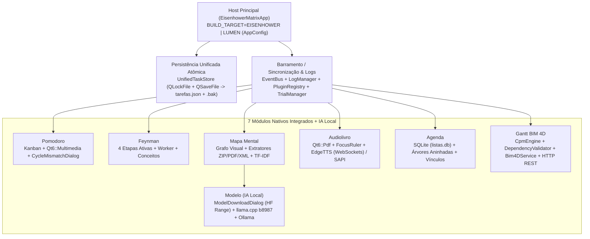

# Arquitetura do Sistema / System Architecture — EISENHOWER ORGANIZER / LÚMEN

  <b>Selecione o idioma / Select language:</b> 
  <a href="#ptbr">🇧🇷 Português (BR)</a> | <a href="#enus">🇺🇸 English (US)</a>

---

## 🇧🇷 Português (BR)

Clique para expandir / recolher a arquitetura em português
 

# EISENHOWER ORGANIZER / LÚMEN — Arquitetura Modular em C++23 e Qt 6.12.0

**Versão:** `2026.11.22.0`  
**Data:** `22 de novembro de 2026`  
**Autor:** Fernando Nillsson Cidade  

---

## 1. Visão Geral em Camadas

O **EISENHOWER ORGANIZER / LÚMEN** adota uma arquitetura modular nativa em **C++23** com **Qt 6.12.0**, compilada em um núcleo host unificado que integra diretamente os 7 espaços de trabalho e o serviço de IA local sob demanda (`Modelo`), enquanto preserva alvos individuais em `source/modules/` e contratos de interface `QObject` / `QLibrary`:

---

## 2. Identidade Dual em Compilação (`AppConfig` & `CMakeLists.txt`)

A seleção do produto é definida em tempo de compilação pela variável CMake `BUILD_TARGET`:

| Parâmetro | `BUILD_TARGET=EISENHOWER` (`APP_EISENHOWER`) | `BUILD_TARGET=LUMEN` (`APP_LUMEN`) |
|---|---|---|
| **Executável Principal** | `EisenhowerOrganizer.exe` | `Lumen.exe` |
| **Diretório `%LOCALAPPDATA%`** | `%LOCALAPPDATA%\EisenhowerOrganizer` | `%LOCALAPPDATA%\Lumen` |
| **Assets Institucionais** | `source/assets/eisenhower/` | `source/assets/lumen/` |
| **Ícone Windows** | `organizador.ico` / `organizador.png` | `autismo.ico` / `autismo.png` |
| **Log Centralizado** | `logs/file_eisenhower_*.log` | `logs/file_lumen_*.log` |
| **Listagem Microsoft Store** | `9P289X0185C3` | `9N70CLLMVRPN` |

O arquivo [`source/utils/AppConfig.hpp`](../source/utils/AppConfig.hpp) também suporta sobrescrita de alvo em ambiente controlado de testes via `EISENHOWER_ORGANIZER_RUNTIME_TARGET` e redirecionamento de log via `EISENHOWER_ORGANIZER_LOG_FILE`, permitindo que `test_ui_host` valide dinamicamente `OpcoesSobre` para ambos os produtos.

---

## 3. Persistência Atômica (`UnifiedTaskStore`) e Banco Local

1. **`UnifiedTaskStore` (`source/utils/UnifiedTaskStore.*`):**
   - Mantém `tarefas.json` sincronizado entre Eisenhower, Pomodoro e Feynman.
   - Utiliza **`QLockFile`** para impedir gravações simultâneas corruptivas e **`QSaveFile`** para substituição atômica em disco, além de snapshot `tarefas.json.bak` e proteção contra sobrescrita quando JSON inválido é detectado.
2. **Bancos Relacionais SQLite (`Qt6::Sql` / `QSQLITE`):**
   - **Agenda (`source/modules/agenda/`):** `listas.db` + `agenda_config.json` + arquivos JSON por agenda personalizada em `agendas/*.json`, com listas dependentes em estrutura hierárquica pai-filho.
   - **Gantt & BIM 4D (`source/modules/gantt/`):** `gantt_database.db` (`GanttDatabase`) armazenando projetos (`Schedule`), itens EAP/WBS (`ScheduleItem`), dependências (`Dependency`), baselines (`Baseline`), calendários úteis/feriados (`WorkCalendar`), avanços físicos (`ProgressUpdate`), links BIM (`BimLink`) e trilha de auditoria (`AuditLog`).
3. **Configurações Isoladas e Cache de Interface:**
   - `layout.json`, `language.json`, `recorrencias_config.json`, `lembretes_locais_config.json`, `tarefas_gerais_font_config.json`, `arquivo_vinculado_font_config.json`, `conceitos_feynman.json`, `mapa_mental_autosave.json`, `mapamental_config.json` e `audiolivro_config.json`.

---

## 4. Subsistemas Especializados

### 4.1. Matriz de Eisenhower & Motor de Layout (`source/app/`)
- Quatro quadrantes com listas separadas de **Pendente**, **Em Progresso** e **Concluídas**;
- Três modos principais em `Configurações -> Layout de Tarefas`:
  - `Layout Matriz 2x2`: grade 2×2 exibindo os quatro quadrantes simultaneamente com abas por estado;
  - `Layout em Abas -> Vertical` e `Horizontal`: colunas horizontais recolhíveis com checkbox no topo, largura compacta (~30 px), título rotacionado em 90° e contorno contínuo nativo;
  - `Layout em Quadrantes`.
- `CalendarDialog` (`source/ui/CalendarDialog/`) com contadores por dia/semana/mês/ano, selos `[Pendente]`, `[Em Progresso]` e `[Concluída]`, abertura por duplo clique em arquivos vinculados e geração assíncrona no `EditTaskDialog` responsivo (`TaskProgressHelper`).

### 4.2. Pomodoro, Feynman e Audiolivro
- **Pomodoro (`source/modules/pomodoro/`):** Máquina de estados foco/pausa curta/pausa longa, áudio WAV via `Qt6::Multimedia`, Kanban integrado (`Todo`/`Doing`/`Done`), avanço automático e `CycleMismatchDialog` com redefinição sincronizada.
- **Feynman (`source/modules/feynman/`):** 4 áreas estruturadas (`Conceito`, `Explique com Simplicidade`, `Lacunas Identificadas`, `Revisão`), worker assíncrono em segundo plano e seleção em lote preservada no menu de contexto.
- **Audiolivro (`source/modules/audiolivro/`):** Leitura de textos planos e documentos PDF (`Qt6::Pdf` / `Qt6::PdfWidgets`), realce palavra/frase/parágrafo sincronizado, **Régua de Foco (`FocusRuler`)**, vozes SAPI offline e catálogo online Edge TTS (300+ vozes via `Qt6::WebSockets` com nomes localizados por `QLocale`).

### 4.3. Mapa Mental & Inteligência Artificial Local Sob Demanda (`Modelo`)
- **Mapa Mental (`source/modules/mapamental/`):** Grafo visual (`Qt6::OpenGLWidgets` / cena gráfica), 4 modos de disposição (`Vertical`, `Horizontal`, `Radial`, `Árvore`), extração de documentos (`PDF`, `EPUB`, `DOC/DOCX`, `TXT`, `MD`, `CSV`, `XLSX`, `JSON`, `DB/SQLite`, `XML` utilizando `QPdfDocument` e `Qt6::CorePrivate::QZipReader`) e motor heurístico TF-IDF / detecção de idioma como fallback garantido.
- **Modelo IA Local (`source/modules/modelo/`):**
  - `ModelDownloadDialog`: download sob demanda de `qwen2.5-3b-instruct-q4_k_m.gguf` (~2,17 GB) do Hugging Face com continuação por **HTTP Range** (pausa/retomada) e exclusão física sob controle do usuário;
  - Inferência local offline via `llama.cpp b8987` (`llama-b8987-bin-win-cpu-x64` e `llama-b8987-bin-win-vulkan-x64`) preservando hierarquias de até 6 níveis (capítulos/seções) em `ia_01_llama_local.*`;
  - `OllamaInstrucoesDialog` e `ia_02_ollama_local.*`: teste local em `http://localhost:11434` e detecção automática de modelos no submenu `Modelos Ollama`.

### 4.4. Cronograma de Gantt & Engenharia 4D BIM (`source/modules/gantt/`)
- Estrutura hierárquica EAP/WBS (`GanttWbsTreeWidget`, `GanttTimelineWidget`) com escalas Dia/Semana/Mês/Ano;
- Validador topológico de dependências **`DependencyValidator`** (detecção de ciclos DAG em ligações `TI`/`FS`, `II`/`SS`, `TT`/`FF`, `IT`/`SF` com defasagem *lag*);
- Motor **`CpmEngine`** calculando Forward Pass (`ES`/`EF`), Backward Pass (`LS`/`LF`), Folga Total e Caminho Crítico;
- **Interoperabilidade & Obra:** `MsProjectXmlConnector` (XML bidirecional MS Project), `CsvExchangeService` + `CsvMappingDialog`, `EisenhowerTaskImportDialog`, `Bim4DSimulationPanel` + `Bim4DService` (status 4D construtivo), `FieldProgressService` (medições e diário de obra), `AuditService` e servidor REST opcional (`HttpServer` + `WebhookDispatcher` + `SecurityService` RBAC e *rate-limiting*).

---

## 5. Arquitetura de Build, Distribuição Limpa e Testes

- **Compilação CMake (`CMakeLists.txt` & `CMakePresets.json`):**
  - Padrão **C++23 estrito** + **Qt 6.12.0**;
  - Builds isoladas para Pure MSVC (`Visual Studio 18 2026` / `MSVC 14.52`, diretórios `build/build_*_msvc`) e MinGW (`GCC 15.1.0` + Ninja, diretórios `build/build_*_mingw`);
  - `cmake/copy_app_assets.cmake` copia apenas `LICENSES/`, documentos por produto (`eisenhower` ou `lumen`) e os 4 ícones exigidos em tempo de execução, mantendo as pastas externas em `D:\MISCELANEAS\VSCode\` limpas e livres de `vc_redist.x64.exe`, `docs/*.md` ou artefatos de teste.
  - O template de ícone Windows [`source/windows_app_icon.rc.in`](../source/windows_app_icon.rc.in) é compartilhado pelos hosts e por `mocks/`, enquanto os scripts Inno Setup e manifests MSIX (`E-AppxManifest.xml`, `L-AppxManifest.xml`) ficam centralizados em `library/`.
- **Suíte Unificada de Testes (`tests/`):** 11 executáveis Qt Test em `build/build_suite_testes_{msvc,mingw}` vinculados à biblioteca estática `EisenhowerTestCore` (sem distribuição externa).

---

## 🇺🇸 English (US)

Click to expand / collapse architecture in English
 

# EISENHOWER ORGANIZER / LÚMEN — Modular C++23 & Qt 6.12.0 Architecture

**Version:** `2026.11.22.0`  
**Date:** `November 22, 2026`  
**Author:** Fernando Nillsson Cidade  

---

## 1. Layered Overview & Dual Build Target (`AppConfig`)

Both **Eisenhower Organizer** (`BUILD_TARGET=EISENHOWER`, `EisenhowerOrganizer.exe`, `%LOCALAPPDATA%\EisenhowerOrganizer`, Store ID `9P289X0185C3`) and **Lúmen** (`BUILD_TARGET=LUMEN`, `Lumen.exe`, `%LOCALAPPDATA%\Lumen`, Store ID `9N70CLLMVRPN`) compile from a single modular C++23 / Qt 6.12.0 codebase governed by [`AppConfig.hpp`](../source/utils/AppConfig.hpp). Host UI integrates all 7 modules and the on-demand `Modelo` Local AI engine while preserving standalone DLL interface contracts (`IPomodoroPlugin`, `IFeynmanPlugin`, `IMapaMentalPlugin`, `IModeloPlugin`, `IAudiolivroPlugin`, `IAgendaPlugin`, `IGanttPlugin`).

## 2. Persistence & Core Infrastructure

- **`UnifiedTaskStore` (`source/utils/UnifiedTaskStore.*`):** Coordinates `tarefas.json` across Eisenhower, Pomodoro, and Feynman using `QLockFile` mutual exclusion, atomic `QSaveFile` replacement, and `.bak` corruption protection.
- **SQLite Repositories (`Qt6::Sql` / `QSQLITE`):** `Agenda` stores custom nested-tree lists in `listas.db` + `agendas/*.json`; `Gantt & BIM 4D` manages `gantt_database.db` (`Schedule`, `ScheduleItem`, `Dependency`, `Baseline`, `WorkCalendar`, `ProgressUpdate`, `BimLink`, `AuditLog`).
- **Centralized Logging & Localization:** `LogManager` writes product-specific logs (`file_eisenhower_*.log` / `file_lumen_*.log`); all modules implement runtime `QEvent::LanguageChange` switching across `pt_BR` and `en_US` `.qm` catalogs.

## 3. Core Subsystems

- **Eisenhower Host & `CalendarDialog`:** 4-quadrant matrix with `Pending`/`In Progress`/`Completed` lists, `2x2 Matrix`, collapsible 90°-rotated `Horizontal Tabs`, `Vertical Tabs`, recurrences, local reminders, responsive `EditTaskDialog` (`TaskProgressHelper`), and multi-format I/O (`JSON`, `CSV`, `XLSX`, `PDF`).
- **Pomodoro & Feynman:** Finite-state timer with `Qt6::Multimedia` WAV alarms, Kanban board, `CycleMismatchDialog`, and 4-stage asynchronous active-recall cards.
- **Mind Map & On-Demand Local AI (`Modelo`):** Visual graph (`Qt6::OpenGLWidgets`), document text extraction (`Qt6::Pdf`, `Qt6::CorePrivate::QZipReader` for EPUB/DOCX/XLSX, CSV/JSON/XML/SQLite), TF-IDF heuristic summarizer fallback, `ModelDownloadDialog` (HTTP Range resume for `qwen2.5-3b-instruct-q4_k_m.gguf`), `llama.cpp b8987` CPU/Vulkan inference, and `OllamaInstrucoesDialog` (`http://127.0.0.1:11434`).
- **Audiobook:** Accessible text + PDF reader (`Qt6::PdfWidgets`), live word/sentence/paragraph highlight, line-by-line `FocusRuler`, local Windows SAPI TTS, and optional `Qt6::WebSockets` Edge TTS integration.
- **4D BIM Gantt Schedule:** Hierarchical WBS tree, `DependencyValidator` (cycle-free DAG validation across `FS`/`SS`/`FF`/`SF` + lag), `CpmEngine` (`ES`/`EF`/`LS`/`LF`/Float/Critical Path), `MsProjectXmlConnector`, `CsvExchangeService`, `Bim4DService`, `FieldProgressService`, `AuditService`, and optional RBAC/rate-limited REST `HttpServer` + `WebhookDispatcher` (`SecurityService`).

## 4. Clean Builds, Deployment & Unified Test Suite

Pure MSVC (`Visual Studio 18 2026`, MSVC `14.52.37025`) and MinGW-w64 (`GCC 15.1.0` + Ninja) share strict C++23 & Qt 6.12.0 presets in [`CMakePresets.json`](../CMakePresets.json). [`cmake/copy_app_assets.cmake`](../cmake/copy_app_assets.cmake) ensures external folders in `D:\MISCELANEAS\VSCode\` ship strictly required runtime assets/icons and app-local CRT DLLs without `vc_redist.x64.exe`, `docs/*.md`, or tests; Windows executable icon embedding uses the shared [`source/windows_app_icon.rc.in`](../source/windows_app_icon.rc.in) template, and Inno Setup scripts plus MSIX manifests (`E-AppxManifest.xml`, `L-AppxManifest.xml`) reside under `library/`. All 11 Qt Test executables link against `EisenhowerTestCore` inside `build/build_suite_testes_{msvc,mingw}` with zero external distribution.

